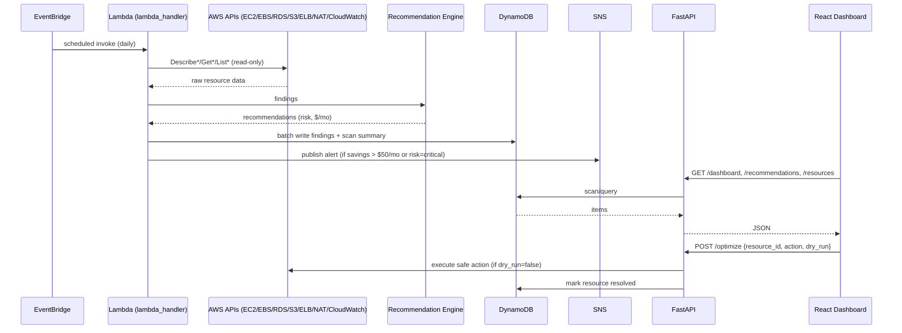

# CloudOptimizer — Architecture

## High-Level Flow

```
 EventBridge (cron, default rate(1 day)) ──or── POST /scan (on-demand)
        │
        ▼
   Lambda: backend/lambda_handler.py :: handler()
        │  runs 7 scanners (boto3): ec2, ebs, eip, rds, s3, elb, nat
        ▼
   Recommendation Engine — backend/recommender/engine.py (pure Python, no AWS calls)
        │
        ▼
   Pricing Engine — backend/pricing/pricing_engine.py (static price table → $/month)
        │
        ▼
   DynamoDB
        ├─ cloudoptimizer-resources-{env}       (current + historical findings)
        └─ cloudoptimizer-resources-{env}-scan-history  (per-scan summary)
        │
        ├──► SNS (if finding.savings > $50/mo OR finding.risk == "critical")
        │
        ▼
   FastAPI backend — backend/api/main.py (reads DynamoDB, exposes REST API)
        │
        ▼
   React Dashboard (Cards, Charts, Resource tables)
```

## Component Responsibilities

**EventBridge** — triggers the scan on a schedule (default: daily). Also supports
on-demand invocation via `POST /scan` on the API, which invokes the same Lambda.

**Lambda (`lambda_handler.py`)** — orchestrates per-service scanners
(`ec2_scanner.py`, `ebs_scanner.py`, `eip_scanner.py`, `s3_scanner.py`,
`rds_scanner.py`, `elb_scanner.py`, `nat_scanner.py`). Each scanner returns a
list of raw `Finding` objects (resource id, region, reason, estimated cost).
The Lambda never makes business decisions itself — it hands raw findings to
the recommendation engine first, keeping "what did we observe" separate from
"what should we do".

**Recommendation Engine** — pure function: `raw findings -> recommendations`.
No AWS SDK calls, so it's trivially unit-testable. Encodes the condition → action →
risk mapping (see `recommendations.json`).

**Pricing Engine** — converts a recommendation into an estimated monthly saving
using a static price table (`pricing/price_table.json`) keyed by resource type
and region. Static table chosen over the live AWS Price List API for v1 because
it removes an external dependency from the hot path and is trivial to keep
"close enough" for a savings *estimate* (not a bill).

**DynamoDB** — two tables. `cloudoptimizer-resources-{env}` (partition key
`ResourceID`, sort key `ScanDate`, GSI on `ResourceType`) stores every finding
from every scan, so history is just a query, not a re-scan; a `Status` field
(`open`/`resolved`) tracks remediation. `cloudoptimizer-resources-{env}-scan-history`
(partition key `ScanID`) stores one summary row per scan run for the trend view.

**SNS** — fan-out for notifications (email today, Slack/webhook is a documented
future enhancement). Triggered by the Lambda after writing findings, based on
thresholds in `notifier.py`.

**FastAPI backend** — thin read/write layer over DynamoDB. Never calls AWS
resource APIs directly (that's the scanner's job) except to invoke the scan
Lambda on `POST /scan` and to execute a remediation on `POST /optimize`.

**React Dashboard** — consumes the REST API only. No direct AWS or DynamoDB
access from the frontend.

## Why this shape
- **Scanner is decoupled from decision logic** so the recommendation rules can be
  changed and unit-tested without touching any AWS credentials or mocking boto3.
- **Static pricing** avoids rate limits/latency from the live Pricing API for
  something that only needs to be directionally correct.
- **Single Lambda entrypoint, multiple scanner modules** keeps the IAM policy on
  the Lambda role auditable — one role, one set of `Describe*`/`List*`/`Get*`
  read permissions, no wildcard `*:*`.

## Sequence Diagram (Mermaid)
Paste into https://mermaid.live for an exportable image, or open
`architecture/cloudoptimizer.drawio` in draw.io for an editable version.



## Data Model

**`cloudoptimizer-resources-{env}`**
| Attribute | Type | Notes |
|---|---|---|
| ResourceID (PK) | String | e.g. `i-0abc123`, `vol-0abc123` |
| ScanDate (SK) | String (ISO 8601) | scan timestamp, enables history per resource |
| ResourceType | String | e.g. `EC2:Idle`, `S3:PublicBucket` — GSI hash key |
| Region | String | |
| Condition | String | human-readable reason the finding fired |
| Recommendation | String | suggested fix |
| Action | String | machine action code (`downsize`, `delete`, `release`, `tag`...) |
| Risk | String | `low` \| `medium` \| `high` \| `critical` |
| EstimatedMonthlySavings | Number | USD |
| Status | String | `open` \| `resolved` |
| Tags | Map | resource's existing AWS tags |
| Metadata | Map | scanner-specific extra fields |

**`cloudoptimizer-resources-{env}-scan-history`**
| Attribute | Type | Notes |
|---|---|---|
| ScanID (PK) | String (UUID) | one row per scan run |
| ScanDate | String (ISO 8601) | |
| total_findings | Number | |
| total_potential_monthly_savings | Number | |
| findings_by_risk | Map | count per risk tier |
